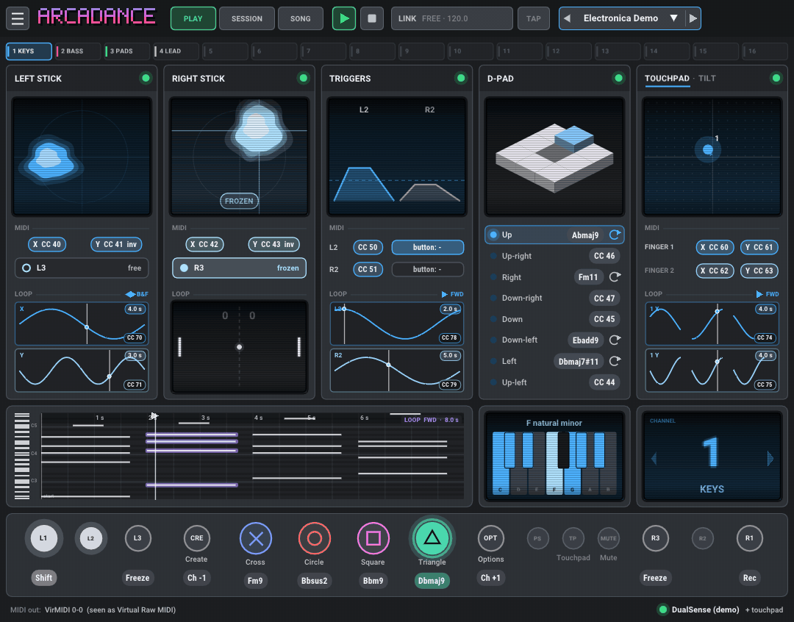
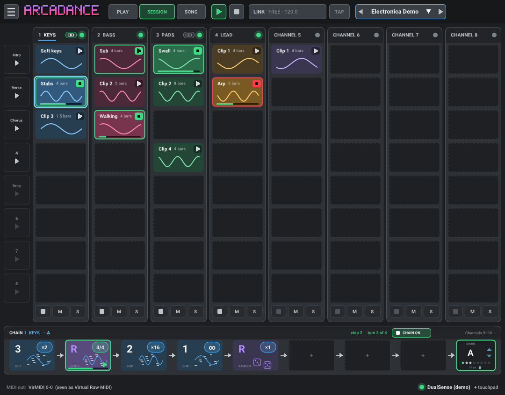
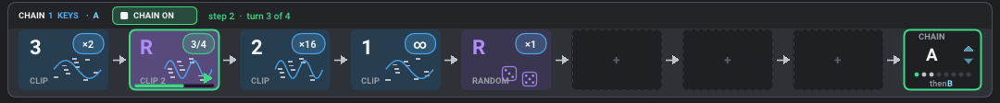
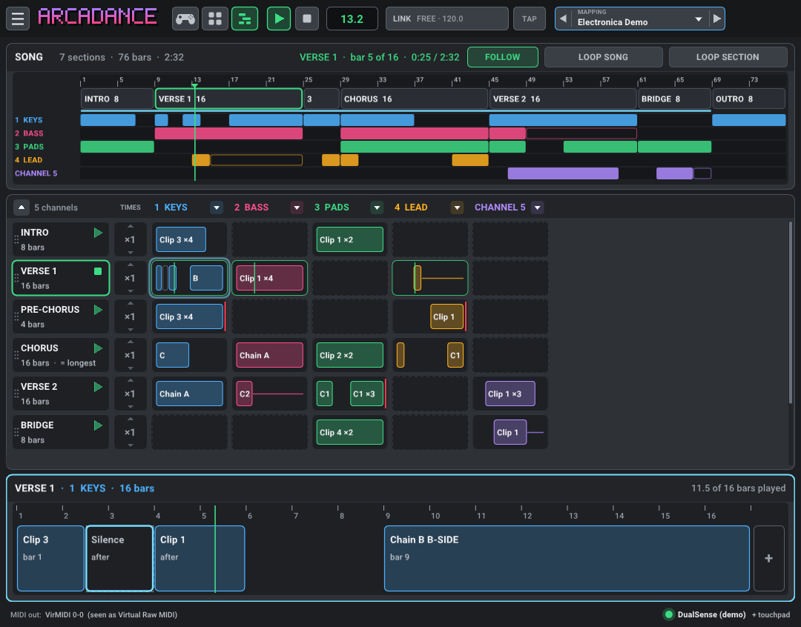
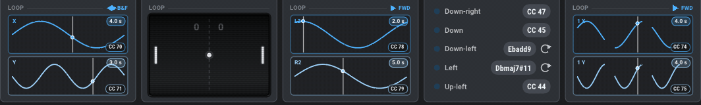
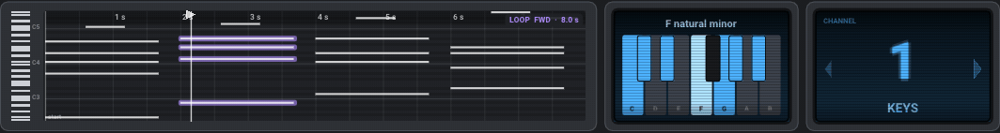
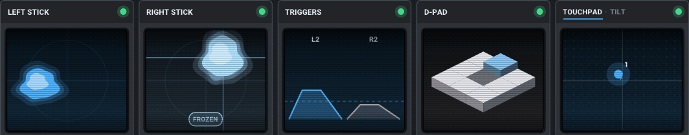
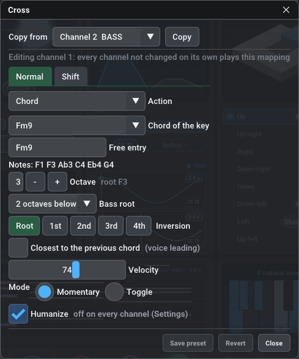
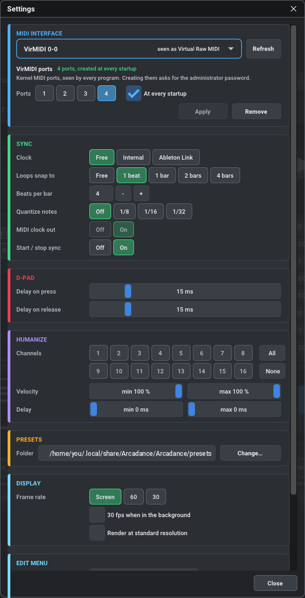

# Arcadance

**Your game controller is now a MIDI instrument and a live looper.**

Pick up the controller on your desk, plug it in, and play your synths with it.
Sticks and triggers sweep filters and effects, buttons fire chords, a tilt of
the controller bends a sound. Hold one button and whatever you play loops at
once: a chord progression, a bassline, a filter gesture. Stack loops on sixteen
channels, turn them into clips, chain them, and build a whole track without
touching the mouse, in time with your DAW through Ableton Link.

It works with the DualSense (PS5), DualShock 4, Xbox, Switch and most other
controllers, and with any DAW, synth or plugin that takes MIDI. Linux for now;
Windows and macOS are planned.

**[Download the latest version](https://github.com/Donmanouche/Arcadance/releases)** ·
**[User manual (PDF)](docs/Arcadance%20User%20Manual.pdf)**



## Why a controller?

Your hands already know it. Two analog sticks, two pressure triggers, a
touchpad, a gyroscope and a dozen buttons: that is more expressive control than
most MIDI controllers, it fits on your lap, and it costs nothing if you already
own one. Arcadance turns all of it into music, and adds what a controller never
had: a looper, clips, chains and a song arranger you drive with your thumbs.

## What it feels like

- **Play chords, not notes.** Give each button a named chord (`Fm9`,
  `Dbmaj7#11`, `Eb9sus4`…), pick a key, and every chord fits. Voice leading
  keeps the voices close from one chord to the next, so a few buttons sound
  like a keyboard player.
- **Draw your automation by hand.** A stick is two CCs, a trigger one more, a
  finger on the touchpad two more, the tilt of the controller two more. Sweep a
  cutoff, ride a send, open a reverb, all at once, with a range and a direction
  you choose for each. Or send aftertouch: press a trigger and the pad swells.
- **Loop as you go.** Hold Record, play, let go: notes and gestures loop
  straight away, in time. Or set Record to toggle, on any channel: press once,
  play a drum groove with both hands, press again. A filter sweep becomes a
  hand-drawn LFO on the very CC you swept, and the stick takes over again the
  moment you touch it; each axis has its own loop and its own length, so
  polyrhythms come by themselves. The D-pad loops too: its CC directions,
  pressed again in time.
- **Loops that keep moving.** Stretch a loop up to 100 times slower or 20 times
  faster, widen or narrow its swing, move it up or down, play it in steps like
  a sequencer, let one loop modulate the depth of others. All while it plays,
  from the controller.
- **Gestures as envelopes.** Set a movement loop to Envelope and it plays once
  from its start each time a note starts: a filter that opens on every chord,
  a hand-drawn attack and decay. Legato restarts it only after a silence.
- **MIDI effects on a button.** Retrigger stutters whatever is sounding on the
  beat, each repeat at its own velocity; Delay echoes what you play, fading
  away with its feedback, or climbing an octave each time. 1/8 down to 1/64,
  triplets too. Record them into your loop and they stay.
- **Sixteen channels, one controller.** Drums on one channel, bass on another,
  pads on a third, each with its own layout, name and colour. Switch while playing;
  every channel keeps looping.

## Build a track with your thumbs



1. **Record clips.** Each channel keeps up to eight clips, each a full set of
   loops. The session screen shows them all, a column per channel. Launch a clip
   and it starts at the end of the current one, so changes always land on the
   beat; launch a whole row at once, and stop it the same way. Name your clips
   and rows, drag clips around with the mouse, select several, undo anything.
2. **Chain them.** A chain plays a channel's clips in order: clip 3 twice, a
   random clip four times, two bars of silence, clip 1 until you move on.
   Eight chains per channel, each going on to the next or looping.
3. **Arrange the song.** The song screen lays out sections (intro, drop,
   break…), and in each one what every channel plays and when. Drag clips and
   chains in on the bar or the beat, stretch a silence to the length you want,
   play from any section, repeat a section, loop any stretch of bars from the
   ruler while you jam over it, or loop the whole song, and watch the playhead
   run across the track.
4. **Save the session.** Clips, chains, song, mapping, key and tempo in one file.
   Start a song from a mapping; once saved, the song keeps its own. Quitting
   asks before losing anything.
5. **Take it to your DAW.** Export a clip or the whole song as a MIDI file, a
   track per channel with its notes and CCs, and drag it into Bitwig, Live or
   any other DAW. The song always starts the same: when a loop stops, its CC
   goes back to where the control rests.





## See every loop

Each part of the controller has its own panel: what you play, what it sends,
and its loops drawn as they play, each with its length, playhead and CC. A rail
above them shows all sixteen channels at a glance, and the modules take the
colour of the channel you play. The piano roll shows the notes you play and
opens into a full editor for the note loop: add, move, stretch or delete notes,
put them on a grid, snap them to the key, set each note's velocity and the
chance it plays, shorten the loop, all without recording again, and every edit
can be undone.





## In time with everything

- **Ableton Link**: join the tempo of Live, Bitwig, a phone app or any Link app
  on your network. Loops snap to the beat and follow tempo changes.
- **Internal clock** with MIDI Clock out, so drum machines and sequencers follow
  Arcadance. Set the tempo with the wheel, type it, or tap it.
- **Or play free**, no grid at all.
- Quantize your notes to 1/8, 1/16 or 1/32 without delaying what you hear;
  humanize velocity and timing for a looser feel.

## Made for the stage

- One window that plays and edits at the same time, fullscreen with **F11**.
- One Play / Stop for every clip or the whole song; Stop again silences
  everything. Launch a clip while stopped and it starts playing.
- Set everything up from the controller: an edit mode puts a cursor on the
  screen, and small menus open on any clip, loop or chain, always in the same
  order, with their keyboard shortcuts. Hold the Mode button
  for a reminder of the controls of the screen you are on.
- A Shift layer doubles every button, and Shift with a stick reshapes your loops
  live.
- Three looks: the default one, or Phosphor Blue and Phosphor Green, glowing
  lines on black like an 80s monitor. Empty loop panels play little arcade games
  while they wait.



## Get started in five minutes

1. Download the AppImage from the
   [latest release](https://github.com/Donmanouche/Arcadance/releases), make it
   executable and run it:

   ```bash
   chmod +x Arcadance-*-x86_64.AppImage
   ./Arcadance-*-x86_64.AppImage
   ```

2. Plug in your controller (USB or Bluetooth). Arcadance names its buttons the
   way they are printed on it.
3. Choose where the MIDI goes (Arcadance asks the first time), and pick that
   port as a MIDI input in your DAW.
4. Load a synth on that track and play. Hold the Loop record button (R1 in the
   demo layout), play, let go: your first loop is running.

Click any control on screen to change what it plays, and hear the change at
once. The [user manual](docs/Arcadance%20User%20Manual.pdf) covers everything,
including setting up your DAW on Linux.



### Touchpad and tilt on a DualSense or DualShock 4

On Linux, the touchpad and the motion sensors need a one-time permission
(everything else works without it, and Arcadance tells you). Create the file
`/etc/udev/rules.d/70-dualsense.rules` with:

```
# USB
KERNEL=="hidraw*", SUBSYSTEM=="hidraw", ATTRS{idVendor}=="054c", ATTRS{idProduct}=="0ce6", MODE="0666"
# Bluetooth
KERNEL=="hidraw*", SUBSYSTEM=="hidraw", KERNELS=="0005:054C:0CE6.*", MODE="0666"
```

then run `sudo udevadm control --reload-rules && sudo udevadm trigger` and
reconnect the controller.

### Your DAW does not see Arcadance?

Most Linux music programs see Arcadance's MIDI port directly. Some only list
hardware ports: Arcadance can then create virtual hardware ports for them
(☰ › **Settings** › MIDI INTERFACE › *VirMIDI ports*, with your administrator
password). Choose `VirMIDI N-0` in Arcadance and `Virtual Raw MIDI` as the input
of the other program.



## Without a window

For a headless rig (a small computer under a synth, for instance):

```bash
./Arcadance-*-x86_64.AppImage --headless my-preset.json
```

Arcadance plays your preset without a window, on a MIDI port named *Arcadance*,
and reloads it whenever you save it. `--headless --help` lists the options.

## Good to know

- **Presets** hold every channel's layout; they are plain text files you can
  share. Sessions hold your loops, clips, chains and song.
- **MidiPad users**: Arcadance was called MidiPad until version 0.238. It takes
  your MidiPad settings, presets and sessions over on its first start, and opens
  MidiPad files as they are.
- **License**: Arcadance is free software under the
  [GNU General Public License v3](LICENSE). It uses
  [Ableton Link](https://github.com/Ableton/link) (GPL v2 or later).
