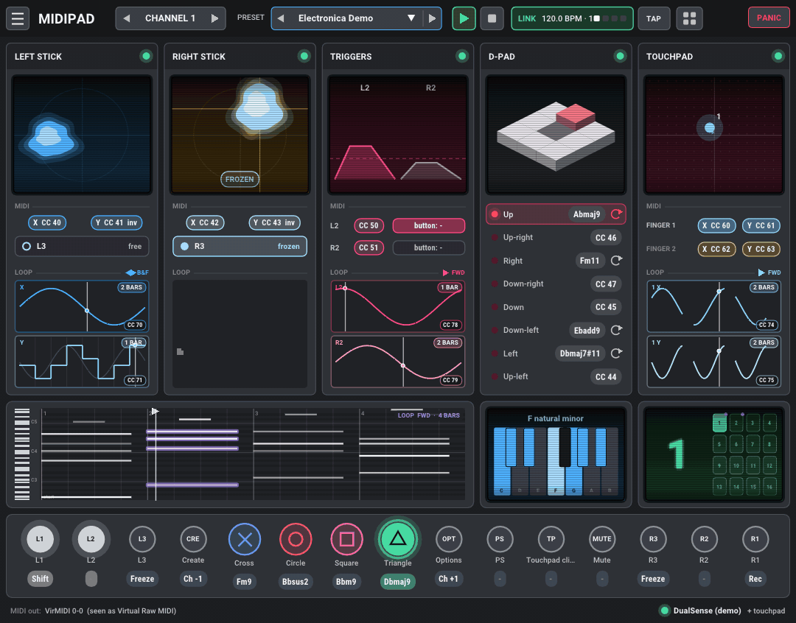
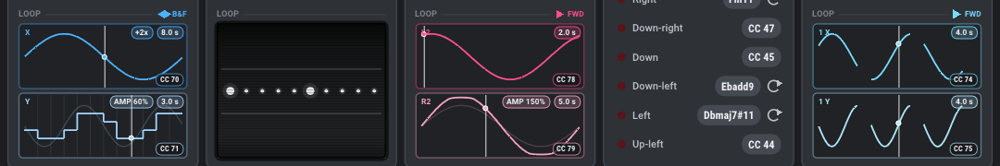
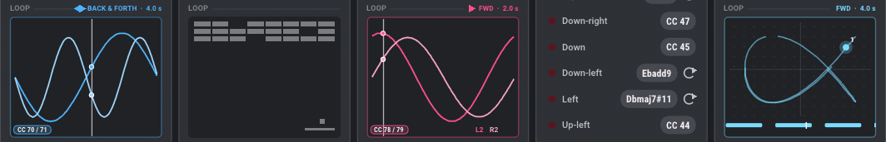
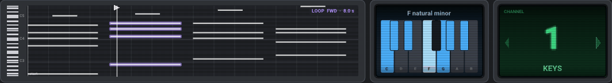
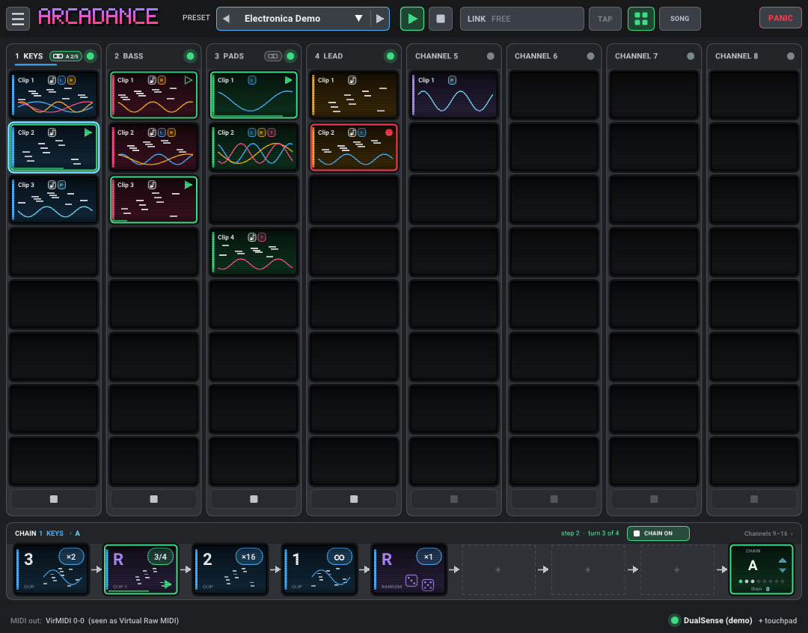
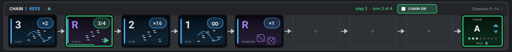
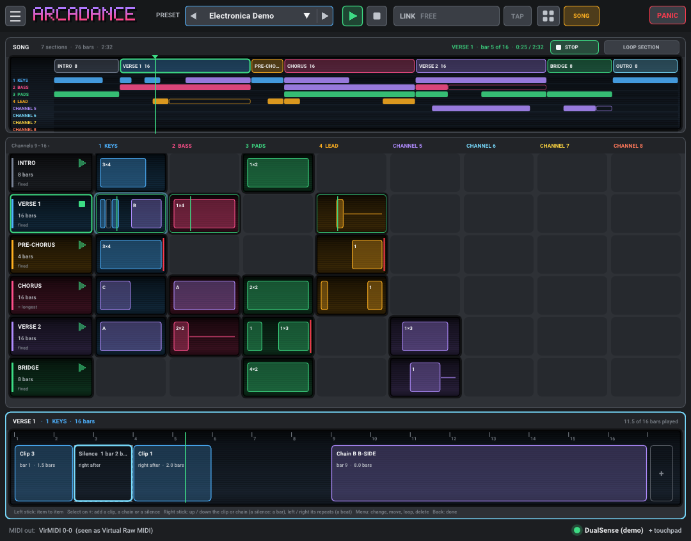
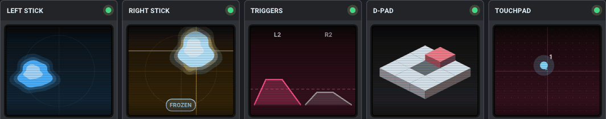
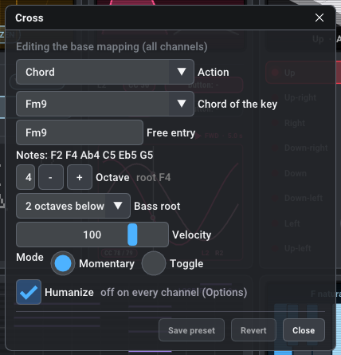
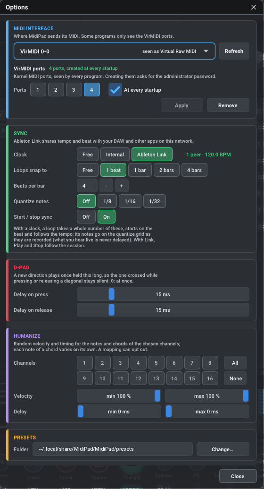

# Arcadance

**Turn a game controller into a MIDI instrument and a live MIDI looper.**

Arcadance turns a DualSense (PlayStation 5) controller into an instrument for your
DAW or synthesizer: the sticks, the analog triggers and the two-finger touchpad
move your sounds, the buttons play notes and chords, and every MIDI channel can
have its own layout. Hold one button, play, release: what you played loops at
once, notes and gestures alike, on as many channels as you like. Then arrange
your loops into clips, chain them, and lay them out into a whole song, right
from the controller.

Arcadance runs on Linux; Windows and macOS versions are planned.

- **Download**: a ready-to-run Linux version is attached to each
  [release](https://github.com/Donmanouche/Arcadance/releases).
- **User manual**: [Arcadance User Manual (PDF)](docs/Arcadance%20User%20Manual.pdf).



## What you can do

- **Loop in your hands.** Loop the notes and chords you play, and the movements
  of the sticks, triggers and touchpad fingers, like hand-drawn LFOs for a
  filter, a pan or an effect. Every MIDI channel has its own loops, all playing
  together: chords on channel 1, a bass line on channel 2, a filter sweep on
  top. Overdub, play forward, backward or back and forth, pause and restart
  everything at once. Lock a loop and recording again keeps it.
- **Each axis loops on its own.** A stick's left-right and up-down moves, L2
  and R2, a finger's two directions are separate loops, each with its own
  length: record one now and the other later, clear one alone. Stretch a loop
  or compress it in time, widen or narrow its swing, shorten or lengthen it,
  or play it in steps, like a step sequencer, without recording it again.
- **Clips, chains and the session screen.** Each channel keeps up to eight
  clips. Launch them in time from the controller, and play them in chains,
  up to eight per channel (see below).
- **Arrange a song.** Lay out sections (intro, verse, chorus…) and, in each,
  the clips, chains and silences every channel plays, on the bar or right
  after one another; play the song from any section and see where it is in
  real time.
- **Edit your loops in a large piano roll.** Move a note, a chord or a
  selection in time and pitch (onto the scale if you like), change their
  length, delete them, shorten or lengthen the loop, all while it plays.
- **Sessions.** Save every channel's clips, chains, the song, the preset, the
  tonality and the tempo in one file, and open them again later.
- **Chords made easy.** Named chords (`Fm9`, `Dbmaj7#11`, `Eb9sus4`…) with octave,
  inversion and doubled bass root; choose a tonality and Arcadance offers only
  the notes and chords of the scale. With voice leading, each chord takes the
  inversion closest to the one before, so the voices move smoothly.
- **Expressive controls.** Two sticks, two analog triggers and two touchpad
  fingers, each with its own controller number, range and direction. Freeze a
  stick at its current value; split the touchpad into four pads.
- **A Shift layer.** Hold or latch a Shift button and the buttons, the D-pad
  and the touchpad pads play a second layout, while the sticks and fingers
  reshape your loops.
- **Sixteen channels, sixteen layouts.** Switch channels while playing; each
  channel can have its own layout and a name (BASS, PADS…), so one controller
  drives a whole multitimbral setup.
- **Program Change** from a button (fixed, next, previous) or by sweeping a
  stick through a range of sounds, with optional Bank Select.
- **Play in time: internal clock, Ableton Link, or free.** Run Arcadance's own
  clock, or join the tempo of your DAW, a phone app or any Link app on the
  network. Loops snap to whole beats, start on the beat and follow tempo
  changes; their notes can be quantized without delaying what you hear. Set
  the tempo with the mouse wheel, type it, or tap it. With the internal clock,
  drum machines and sequencers can follow Arcadance.
- **Accents on your loops.** Give a stick or a trigger to the velocity and
  it makes the notes you play, or the note loop already playing, louder or
  softer, keeping the accents you played.
- **Humanize** velocity and timing per channel.
- **Set it up from the controller.** An edit mode puts a cursor on the screen:
  open a control's settings, lock or clear a loop, duplicate a clip or edit a
  chain from small menus, the same ones a right-click opens; the right stick
  changes the channel. You choose which buttons select, open menus and go back
  (Select and Menu can share one button); hold the Mode button for a help of
  the screen you are on.
- **Built for the stage.** One window that plays and edits at the same time,
  a PANIC button, and a mode without any window.

## Loops you can see

Each module shows its loops as lanes, one per axis, each with its own length,
playhead and controller number. Reshape them while they play, from the
controller (Shift and a stick) or with the mouse wheel. A LOOP panel with
nothing recorded yet plays a little 80s arcade game on its grey screen
(Pac-Man, Tetris, Asteroids, Q*bert…), so you see at a glance which ones are free.







## Clips, chains and the session screen



Each channel keeps up to **eight clips**, each a full set of its loops (notes,
sticks, triggers, touchpad). The **session screen** shows them all, a column
per channel, and plays them live:

- Open it with a controller button of your choice (the PS button by default),
  the button with four squares in the top bar, or Tab.
- Move with either stick or the D-pad; press L3 or R3 to launch a clip. It
  starts at the end of the clip playing on that channel, in time, so changes
  always land on the beat. Press it again to stop.
- Put the cursor on an empty slot and record as usual: the take becomes a new
  clip there.
- Every channel plays its own clip: switch the drums on channel 1 while the
  bass carries on on channel 2.

Under the clips, a **chain** of the active channel plays its clips in
sequence, up to eight steps. Each channel has up to **eight chains** (A to H),
chosen in the CHAIN cell at the end of the strip:



- Each step is a clip and how many times it plays: ×1 to ×64, or ∞ until you
  move on. After the last step the chain goes back to the first, stops, or
  goes on to another chain.
- **R** picks one of the channel's clips at random each time the chain comes
  to it, for an arrangement that never plays twice the same.
- Set the steps from the controller (the right stick chooses the clip and the
  repeats, L3 starts the chain or moves on, R3 empties a step) or with the
  mouse (drag a clip onto a step, turn the wheel).
- The CHAIN cell shows which chain you see (arrows, the wheel or the right
  stick show another) and plays it; its menu sets what follows it, and
  duplicates, renames or clears it.

## Arrange a song



The **song screen** (press the Mode button again from the session screen, Tab,
or the SONG button) lays your clips and chains out in time:

- A song is a list of **sections**, as many as you like, each with its name
  and its length in bars (or as long as its longest channel).
- In each section, every channel plays **clips, chains and silences**, one
  after the other or each on a bar of its own. Pick them from the list the +
  opens, or add a clip or a chain to the song from its menu in the session
  screen. After its repeats an item is silent, or loops on until the next one.
- The top of the screen shows the whole song at scale, a lane per channel,
  with a playhead in real time; play it from any section, at the next bar,
  or loop the section playing.
- Everything works from the controller (cursor, Select, Menu, the right stick
  for lengths and repeats) and with the mouse (click, drag, wheel).

## Getting started

1. Download the AppImage from the
   [latest release](https://github.com/Donmanouche/Arcadance/releases), make it
   executable and run it:

   ```bash
   chmod +x Arcadance-*-x86_64.AppImage
   ./Arcadance-*-x86_64.AppImage
   ```

2. Connect the controller (USB or Bluetooth).
3. Choose where the MIDI goes (Arcadance asks on the first launch), and select
   that port as a MIDI input in your DAW.
4. Play. Hold the Loop record button (R1 in the demo layout), play, release:
   your loop plays.

The user manual walks through every step, with your DAW on Linux.

### Touchpad access (Linux)

To use the touchpad, Linux needs a one-time permission. Without it the
controller works, but without the touchpad, and Arcadance says so. Create the
file `/etc/udev/rules.d/70-dualsense.rules` with:

```
# USB
KERNEL=="hidraw*", SUBSYSTEM=="hidraw", ATTRS{idVendor}=="054c", ATTRS{idProduct}=="0ce6", MODE="0666"
# Bluetooth
KERNEL=="hidraw*", SUBSYSTEM=="hidraw", KERNELS=="0005:054C:0CE6.*", MODE="0666"
```

then run `sudo udevadm control --reload-rules && sudo udevadm trigger` and
reconnect the controller.

## The window

The window is an animated view built for the stage, which plays while it edits.
**F11** toggles fullscreen, **Ctrl+S** saves the preset, **Ctrl+Q** quits.



- One module per part of the controller: left and right sticks, triggers,
  D-pad, touchpad. Each has an animated screen that follows the controller,
  what it sends, and a LOOP panel.
- Below the modules: the piano roll, the SCALE block (the tonality on a
  one-octave keyboard; click to choose it) and the CHANNEL block (the active
  channel in large digits and its name; its arrows or the wheel change the
  channel, a click renames it).
- A strip of pads for the buttons (✕ ○ □ △ in PlayStation colours): they flash
  on every press and stay lit while their note or chord sounds.
- At the top: the ☰ menu (sessions, Options, About), the preset, ▶ / ■ for
  the loops, the clock and its tempo, TAP, the session and song screens and
  PANIC.

Click a control (a pad, a D-pad direction, a touchpad zone, a stick, a LOOP
panel) to set it up in a window over the view, and hear the change at once.
Channel 1's layout plays on every channel that has none of its own; change a
control on another channel and that channel gets its own layout. Buttons, D-pad
directions and touchpad pads have a Normal and a Shift tab.



**Presets**: the PRESET menu (with previous / next) opens a preset, and offers
New…, Save as… and Delete…. A preset holds every channel's layout.

**Tonality** (optional, shared by all channels), chosen by clicking the SCALE
screen: a root and a scale (major, natural, harmonic and melodic minor, the
modes, pentatonics, blues, whole tone). Arcadance then offers only the notes of
the scale and, for chords, every chord of the key, degree by degree. Anything
outside the scale stays possible, and is flagged.

**Options** (☰ menu): the MIDI output, the clock and the loops' timing, the
D-pad's response, humanization, the presets folder and the display.



### MIDI ports on Linux

Most Linux music programs see Arcadance's own MIDI port directly. Some only see
hardware MIDI ports: for them, Arcadance can create virtual hardware ports
(☰ › **Options** › MIDI INTERFACE › *VirMIDI ports*, with your administrator
password). Choose `VirMIDI N-0` in Arcadance and `Virtual Raw MIDI` as the input
of the other program. Arcadance finds its port again at every start.

## Playing without a window

```bash
./Arcadance-*-x86_64.AppImage --headless my-preset.json
```

Arcadance then runs without a window: it creates a MIDI port named *Arcadance* to
connect to your DAW and plays your preset, reloaded as soon as you save it.
`--headless --help` lists the options (another port, the starting channel, a monitor of
what is sent).

## Coming from MidiPad

Arcadance was called MidiPad until version 0.238. On its first start it takes
your MidiPad settings, presets and sessions over, once, and leaves the MidiPad
folder as it was. Files made by MidiPad still open.

## License

Arcadance is free software under the [GNU General Public License v3](LICENSE).
It uses [Ableton Link](https://github.com/Ableton/link) (GPL v2 or later).
